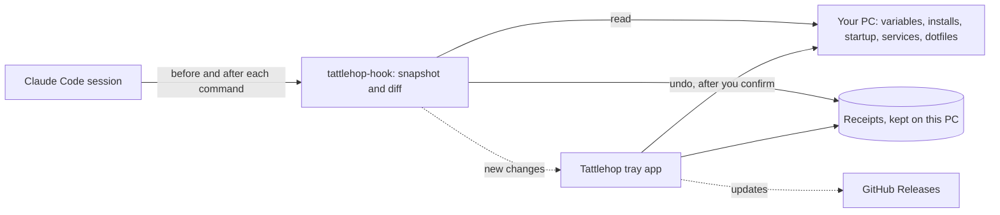

<h1 align="center">
  <picture>
    <source media="(prefers-color-scheme: dark)" srcset="docs/brand/lockup-dark.svg">
    
  </picture>
</h1>

**See what your coding agents changed on your PC outside the repo, and undo it.** Every command an agent runs gets a receipt.

Git shows what an agent changed in your repo. It doesn't show the global npm package, the PATH entry, the `.gitconfig` line or the startup entry it added along the way. On Windows, Claude Code's sandbox [doesn't run at all](https://code.claude.com/docs/en/sandboxing), so an agent's commands can do anything you can. Run three agents at once, and nobody can say which one did it.

> **Status:** planning. There's no code or release yet. See [ROADMAP.md](ROADMAP.md). Until Tattlehop ships, see [Alternatives](#alternatives).

## Before and after

| You… | Without Tattlehop | With Tattlehop |
|---|---|---|
| find TypeScript installed globally, at a version you never picked | you guess which session ran `npm i -g`, or search the transcripts | its receipt names the command and the session, with Undo |
| spot a new PATH entry | you wonder where it came from | the receipt shows the entry, the command that added it, and Undo |
| had an agent run `git config --global` | your commits go out under a test email until someone notices | the `.gitconfig` diff is on the receipt, and Undo puts the old file back |
| run three agents at once | nobody can tell whose install it was | each change says which command was running when it happened, or "one of these" when two were |
| reboot, and a new app starts with Windows | you hunt through Task Manager's Startup tab | the startup entry is on the receipt of the command that added it |

## What it does

Planned for 1.0:

- **A receipt for every command.** Before and after each Bash or PowerShell call an agent makes, Tattlehop takes a snapshot of the places agents change outside the repo, and records what's different.
- **Fair blame.** A change found while one command ran is tied to that command and its session. If two commands were running, the receipt says "one of these". A change made between commands is "not tied to a session". Receipts say "while", not "by": a change you make yourself in the middle of an agent's command lands there too.
- **What it watches:**
  - user and machine environment variables;
  - installed apps, including winget's, and global `npm`, `pip --user` and `dotnet tool` packages;
  - startup entries, your scheduled tasks and services;
  - dotfiles and tool configs such as `.gitconfig`, `.npmrc`, `.ssh/config` and your PowerShell profile;
  - new items at the top of your home folder, and any file an agent's Write or Edit touched outside the repo.
- **Undo, once you confirm.** Changes that don't need admin are undone in place: a PATH entry, a global package, a startup entry, a dotfile. A change that needs admin shows the exact command to run in an admin terminal.
- **Claude Code first,** through a plugin you add yourself. Other agents come later.

## The trust contract

Tattlehop reads your environment, your configs and what your agents ran, so it has to be easy to trust.

- **Read-only until you confirm an undo.** Taking a snapshot changes nothing.
- **No network, except updates.** The tray app checks GitHub Releases for a new version, and you can turn that off. That's its only network call: there's no telemetry, and nothing about your PC is sent.
- **Nothing leaves your PC.** To put a dotfile or variable back, Tattlehop keeps its old value, encrypted with Windows DPAPI so only your account on this PC can read it, and deletes it after 30 days. Values that look like secrets are masked on screen.
- **Runs unelevated.** It never asks for admin.
- **Never blocks your agent.** If Tattlehop fails or runs slow, the command runs anyway. A snapshot has a budget of 100 ms.
- **Leaves your Claude Code settings alone.** You add its hooks as a plugin, so you see them before they run.
- **Open source,** so you can check all of this instead of trusting it.

## How it works

## Alternatives

Checked against each one's own docs on 2026-10-24.

| | Tattlehop (planned) | [aGiTrack](https://pypi.org/project/agitrack/) 0.6.30 | [Process Monitor](https://learn.microsoft.com/en-us/sysinternals/downloads/procmon) 4.12 | [whatileaked](https://github.com/selan-ai/whatileaked) | [System Restore](https://support.microsoft.com/en-us/windows/use-system-restore-a5ae3ed9-07c4-fd56-45ee-096777ecd14e) |
|---|---|---|---|---|---|
| Looks at | your PC outside the repo | changes inside the repo | every file, registry and process event | credentials in agent transcripts | system files, apps and settings |
| Ties a change to | the agent command running when it happened | the agent turn that made it | the process that made it | the transcript it's in | a point in time |
| Undo | each change, after you confirm | a git commit for each change | none | none: you rotate what it finds | the whole PC, back to a restore point, with a restart |
| How you run it | beside Claude Code, through its hooks | you start your agent through it | capture while it runs, then filter the raw log | `whatileaked scan`, on demand | built into Windows |
| Status | planning | active, Apache-2.0 | free, from Microsoft Sysinternals | MIT, no network | built in |

**Use aGiTrack** for a reviewable history of what agents did inside the repo. It works with Claude Code, Codex and OpenCode, and it pairs with Tattlehop, which looks outside the repo. **Use Process Monitor** when you need to know exactly which process wrote a file or key: it sees everything, but you dig through a raw log. **Use whatileaked** to find secrets you already pasted into an agent. **Use System Restore** when an install broke Windows itself: it rolls the whole system back without touching your personal files. **Run Claude Code in WSL2** if you'd rather stop writes outside the project than review them: its sandbox works there and on macOS and Linux, but not on native Windows.

## Contributing

Issues are welcome. Planning lives in [ROADMAP.md](ROADMAP.md).

## License

[Apache-2.0](LICENSE). Tilly, the clerk in this README, was drawn with an AI image model and is Apache-2.0 like the code.
