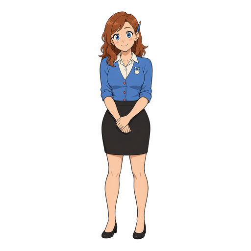

# Tattlebun brand

The logo is a placeholder: a wide-eyed bunny peeking over a receipt, with one ear perked, as Tattlebun keeps a receipt of what your agents changed. It's drawn to stay apart from Shybun's bunny, whose eyes are closed. The real logo is an owner item in M0 of the [roadmap](../../ROADMAP.md), to be picked in a claude.ai design project. The mascot is [Tilly](#tilly).

- `mark.svg` / `mark-dark.svg`: the bunny-and-receipt mark, for light and dark backgrounds.
- `lockup.svg` / `lockup-dark.svg`: the mark plus the "tattlebun" wordmark, as in the README's title.
- The wordmark is Fredoka SemiBold (SIL Open Font License), lowercase, with -0.01em letter spacing, converted to paths because GitHub can't load web fonts inside SVGs. It's the same face as Staypaw's, Sweepling's and Shybun's. Use the SVGs; don't re-typeset it. `scripts/make_lockup.py` rebuilds both lockups from the font and the mark, and its header says how. Rerun it whenever the mark changes.

Logo colours: ink `#1d1a16` and cornflower `#3e66c0` on light backgrounds, paper `#f2ede2` and cornflower `#8fb0f5` on dark ones.

## Tilly

Tilly Stubbs is a front-desk clerk who notices every little change and can't wait to tell you exactly what happened, fairly and kindly. She is the mark's bunny-over-a-receipt as a person: a witness on your side, never a snoop. Receipts say "while", not "by", so she tells and never accuses. Her bunny-head pin is her one bunny cue, and with the pencil behind her ear it's in every image. She is the face of the README and launch posts; the bunny mark stays the logo and the tray icon.

| File | Shows | Means |
|---|---|---|
| `tilly/base.png` | Full body, hands clasped | Her reference |
| `tilly/over-the-receipt.png` | Peeking over a long receipt | A receipt for every command |
| `tilly/psst.png` | A hand beside her mouth, eyes glancing aside | New changes found: the tray count rises |
| `tilly/undo.png` | Rubbing out a line with her pencil's eraser | An undo you confirmed |

- The PNGs are 512 px square with transparent backgrounds. The stickers have a white die-cut border; `base.png` has none.
- Her colours, sampled from `tilly/base.png`: hair `#A05531`, skin `#FAC8A4`, cardigan `#507DBF`, shirt and pin `#F7EEDD`, skirt and pumps `#332E2C`, and stamp red on her buttons and the eraser. Her cardigan sits near the logo's cornflower but lighter, and isn't retinted to match. None of them is a text colour.
- Her art is AI-generated with OpenAI's gpt-image-2.5-flare, from a written character spec, and like the code it is Apache-2.0. Don't edit or redraw her here; new stickers come from the same spec, so the set stays consistent. Two more aren't published: one-of-these, whose see-through gaps show a dark page through it, and all-clear, not drawn yet.

 
